# SunLedger

**Independent, owner-consented health records for Australia's home batteries.** Owners connect their system for free; installers, insurers and green lenders pay for verifiable outputs derived from that record. SunLedger never sells raw data.

> Status: pre-pilot concept and working demo (20 Nov 2026). All data is synthetic. Battery brands and models, homes, owners, installers and insurers in the demo are fictional. Manufacturer names appear only as real API integrations, no synthetic site is linked to a real platform, and no figure here is a statement about any manufacturer's products.

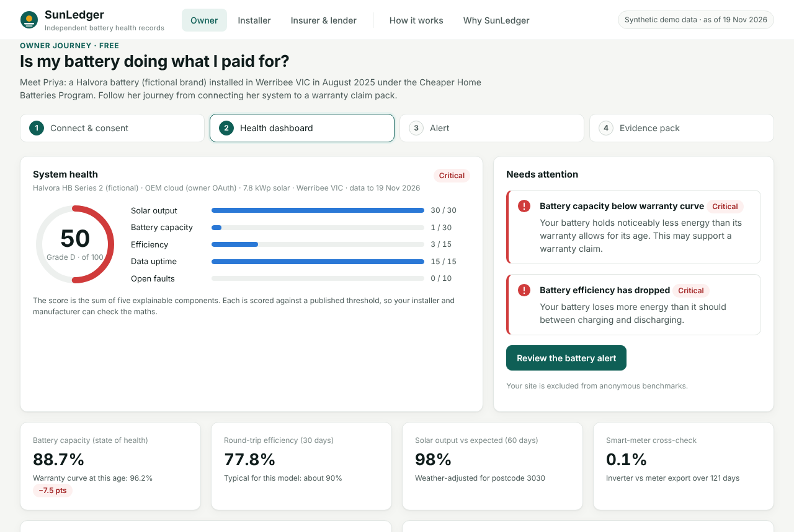

**Contents:** [Problem](#the-problem) · [Solution](#the-solution) · [Why now](#why-now) · [How it works](#how-it-works) · [Customer journeys](#customer-journeys) · [Business model](#business-model-and-revenue) · [Data sources](#data-sources-and-their-validity) · [Demo](#demo-walkthrough) · [Quickstart](#quickstart) · [Architecture](#architecture-and-tech-decisions) · [Real vs simulated](#what-is-real-vs-simulated) · [Risks](#risks-what-must-be-true) · [90-day plan](#90-day-plan) · [Layout](#project-layout) · [Sources](#sources)

---

## The problem

Australia installed half a million home batteries in about a year, and nobody neutral holds the evidence of how they perform.

| Signal | Number | Source |
|---|---|---|
| Batteries installed under the federal Cheaper Home Batteries Program (from 1 Jul 2025) | **500,000+** by 14 Aug 2026 | [PM media release][pm-500k] |
| Consumer reports to the ACCC about household batteries and new energy services | **+107%** in 12 months | [ACCC, 10 Jul 2026][accc] |
| Independent dispute resolution under the New Energy Tech Consumer Code | **None** | [ACCC, 10 Jul 2026][accc] |
| Battery installation inspections completed by the Clean Energy Regulator | **~1,000** by Feb 2026 | [CER, Feb 2026][cer] |
| Limited fire-risk recall by a top-selling home battery brand | Nov 2025 | [RenewEconomy][recall] |
| VPP participation among battery owners across the NEM | **~24%** (ACCC estimate); **4 to 10%** in a household survey | [Energy Consumers Australia, Jul 2026][eca] (reports both) |

Three people feel this, and none of them has an independent record:

| Persona | Job to be done | Pain today |
|---|---|---|
| **Owner** (rebate-funded household) | "Is my battery doing what I paid for? If not, get it fixed under warranty." | The OEM app shows state of charge, not degradation against the warranty. No evidence that will stand up with the installer or manufacturer. |
| **Installer ops manager** (mid-size installer, 40 to 150 jobs a month, hypothesis) | "Find sick systems before the customer calls; prove my installs were right." | Callbacks are reactive. Data is split across 4 to 6 OEM portals (hypothesis). No install proof for CER inspections or disputes. |
| **Insurer / lender (underwriter)** | "Price the battery risk on this property or loan." | Pricing an A$10k+ asset (hypothesis) blind: install date and brand, no condition data. |

## The solution

A read-only, cross-brand **battery health record** built from the owner's own consented API connections:

- **Owners (free):** health score, capacity vs warranty curve, plain-English alerts, and a one-click warranty and Australian Consumer Law evidence pack.
- **Installers (paid):** one triage queue across every OEM portal, commissioning proof for each job, and de-identified peer benchmarks.
- **Insurers and lenders (paid):** a verifiable health certificate the owner shares with a named recipient; its ID is a SHA-256 fingerprint of its contents, so it is integrity-checked (hash); signing is planned.

**Consent is not a licence to resell.** Platform terms restrict onward sharing: the [Tesla Fleet API Agreement][tesla-agreement] §5.6.7 bars partners from making User Personal Data available "to any third party other than to Users in the Application, without a valid legal basis". That supports an owner-directed model: SunLedger sells **derived outputs** produced for, or at the direction of, the owner, never raw telemetry.

## Why now

1. **Volume:** the rebate created a large, new, warranty-bound installed base in about a year, much of it installed by businesses new to storage.
2. **Friction:** consumer reports have more than doubled and the industry code has no independent dispute resolution, so owners need their own evidence.
3. **Access:** the main platforms now expose official APIs (SolarEdge v2, Enphase API v4, Tesla Fleet energy endpoints, SMA, and Sungrow and Alpha ESS developer APIs), and the Energy Consumer Data Right gives an independent smart-meter cross-check.
4. **Trust gap:** most owners keep control of their battery rather than join a VPP. A read-only product that never touches settings is an easy yes.

## How it works

### Architecture

```mermaid
flowchart LR
  subgraph SRC["Consented sources (read-only)"]
    SE["SolarEdge Monitoring API v2"]
    EN["Enphase API v4"]
    TS["Tesla Fleet API (energy)"]
    SMA["SMA API"]
    SG["Sungrow / Alpha ESS<br/>developer APIs (simulated)"]
    PG["Sigenergy / Fronius<br/>partner or contract (simulated)"]
    CDR["Energy CDR<br/>smart meter"]
  end

  subgraph SL["SunLedger"]
    CL[("Consent ledger<br/>append-only events")]
    AD["Source adapters<br/>plan, fetch, land verbatim"]
    RAW[("raw.api_payloads<br/>JSON")]
    STG["dbt staging<br/>one model per API shape"]
    INT["dbt intermediate<br/>canonical daily model, SoH, RTE, faults"]
    MART["dbt marts<br/>health, alerts, fleet, benchmarks"]
    EV["Evidence packs<br/>AI narrative over data facts"]
    CERT[("Certificates<br/>SHA-256 content IDs")]
    API["FastAPI"]
  end

  SRC --> AD --> RAW --> STG --> INT --> MART
  CL --> INT
  MART --> EV --> API
  MART --> CERT --> API
  API --> O["Owners: free"]
  API --> I["Installers: per site per month"]
  API --> U["Insurers and lenders: per certificate"]
```

### Data flywheel

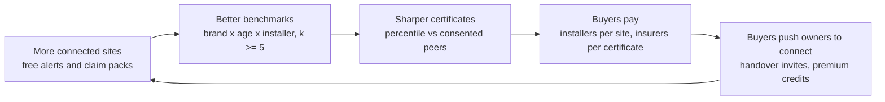

Benchmarks use only sites whose owners separately opted in to `benchmark`, with a minimum cohort of five.

### Consent, health record and certificate verification

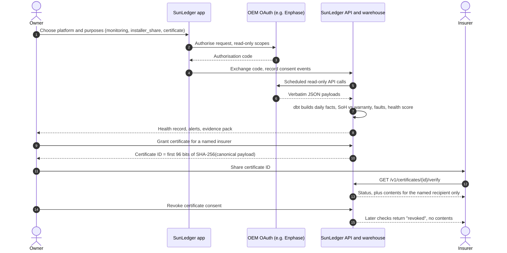

## Customer journeys

**Owner (free).** Trigger: rebate install, bill shock or a neighbour's story.

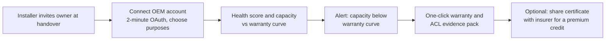

**Installer ops manager (pays per site).** Trigger: callback costs and CER inspection risk.

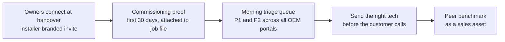

**Insurer / lender (underwriter, pays per certificate).** Trigger: a battery on a home policy or a green loan application.

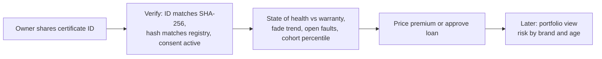

## Business model and revenue

The owner product is free and is the acquisition channel. The first customer is a mid-size Victorian installer that invites owners to connect at handover.

| Buyer | What they pay for | Price (hypothesis) | When |
|---|---|---|---|
| Owner | Nothing: health record, alerts, evidence packs | Free | Day one |
| Installer | Fleet triage, commissioning proof, peer benchmarks | **A$1 to 3 per site per month** | Pilot (once fleet > 25 sites) |
| Insurer / lender (underwriter) | Verifiable health certificate | **A$20 to 50 per certificate** | Pilot with one partner |
| Insurer / lender (underwriter) | Portfolio monitoring subscription | To be priced | After certificates |

Rules that do not change with price: benchmarks come only from separately consented sites (k >= 5), and raw data is never sold.

The chart below is an **illustrative scenario, not a forecast**: 2,000 installer-shared sites at A$2 per site per month (A$48,000 a year) and 1,000 certificates at A$35 (A$35,000).

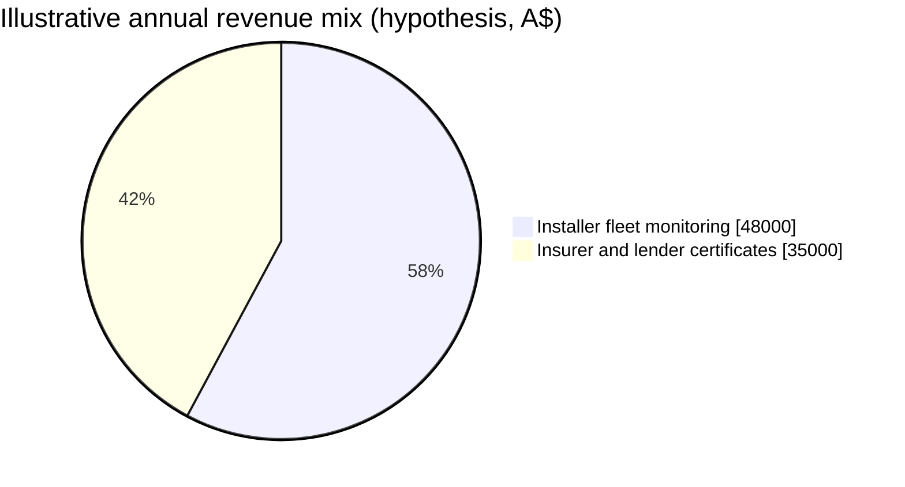

## Data sources and their validity

Checked 20 Nov 2026 (public sources). "Simulated" means the demo serves synthetic data in that source's place.

| Source | Access model | Status | In the demo | Evidence |
|---|---|---|---|---|
| SolarEdge Monitoring API v2 | Registered app (client ID and secret) on SolarEdge ONE for Developers, then OAuth 2.0 per site; calls consume monthly credits | V2 live; V1 retirement scheduled for 1 Nov 2026 (completion not independently confirmed) | Adapter, payload shapes modelled | [openHAB binding][se-openhab], [HA community][se-ha] |
| Enphase API v4 | Self-serve developer portal; system-owner authorisation; Watt plan free (1,000 hits per month), Kilowatt and Megawatt paid | Live | Adapter, payload shapes modelled | [Developer plans][en-plans], [FAQ][en-faq] |
| Tesla Fleet API (energy) | Partner account and virtual key; read scope `energy_device_data`; `live_status`, `site_info`, `calendar_history`; §5.6.7 limits onward sharing | Live | Adapter, payload shapes modelled | [Energy endpoints][tesla], [Scopes][tesla-scopes], [Agreement][tesla-agreement] |
| SMA | OAuth code flow; client credentials set up by SMA API Developer Support (not self-serve) | Live, assisted onboarding | Adapter, set names approximated | [SMA developer FAQ][sma] |
| Sungrow iSolarCloud | Official developer portal (developer-api.isolarcloud.com); API key or OAuth2 | Official API; app review reported by one developer, not confirmed in Sungrow docs | Simulated bridge feed | [sungrow-api-client][sg-1], [Sungrow-API][sg-2] |
| Alpha ESS | Official Open API on the AlphaCloud developer platform; free developer registration (AppID and secret); systems bound by serial number and check code, not owner OAuth | Official API | Simulated bridge feed | [open.alphaess.com][aess], [alphaess-openAPI][aess-gh] |
| Sigenergy | Northbound API used by monitoring platforms; owner authorises API access in their Sigenergy account; no public developer docs found | Partner or integration access | Simulated bridge feed | [meteocontrol guide][sig] |
| Fronius | Solar.web Query API for business partners: contract, order form and paid data packages (free demo on sample systems only) | Contract-based | Simulated bridge feed | [Fronius API access][fronius] |
| Energy CDR | CDR representative model: an unaccredited business uses CDR data under an unrestricted accredited person; meter and tariff data only, no inverter data | Live in energy since Nov 2022 | Adapter (CDS `EnergyUsageRead` shape) | [CDR accreditation guidelines v5][cdr] |

## Demo walkthrough

Download [`demo/index.html`](demo/index.html) (GitHub shows its source, not the page) and open it locally in any browser. It is a single self-contained file (inline CSS, JS and SVG, data embedded) and works offline. Print works when the file is opened locally; sandboxed previews block it and show a note instead. Exports are reproducible: the build date is pinned to the data as-of date, and only the evidence-pack generation date varies.

| | |
|---|---|
| **1. Connect and consent.** The owner picks the platform their system reports to (any owner-OAuth platform continues the demo) and grants each purpose separately. Gated platforms explain the CDR fallback. 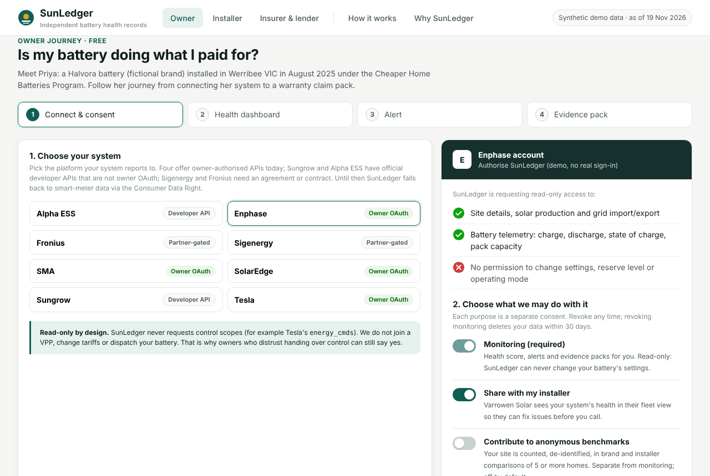 | **2. Health dashboard.** An explainable 0 to 100 score, capacity against the warranty curve and generation against a weather model.  |
| **3. Installer triage.** Every shared site ranked by what needs a truck first, with commissioning proof per job. 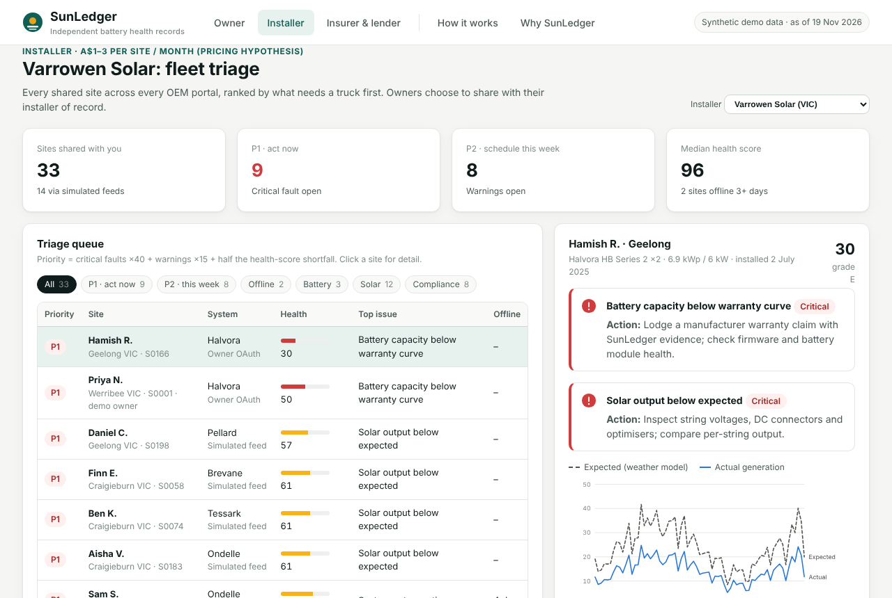 | **4. Certificate verification.** The insurer checks the ID against the SHA-256 of the contents. A tamper test and an owner revocation are one click each. 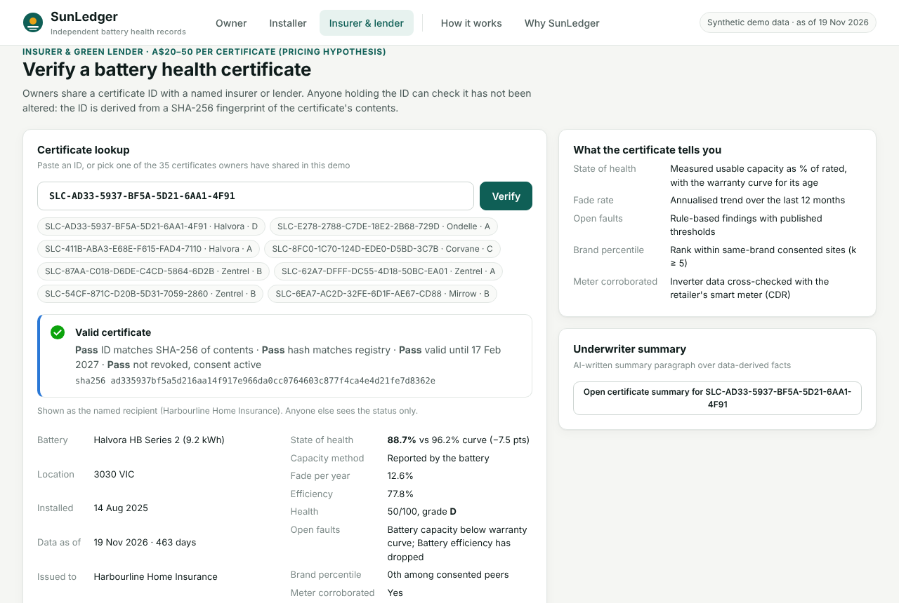 |
| **5. How it works.** Consented sources, the pipeline and the buyers, with the live access mix of this build. 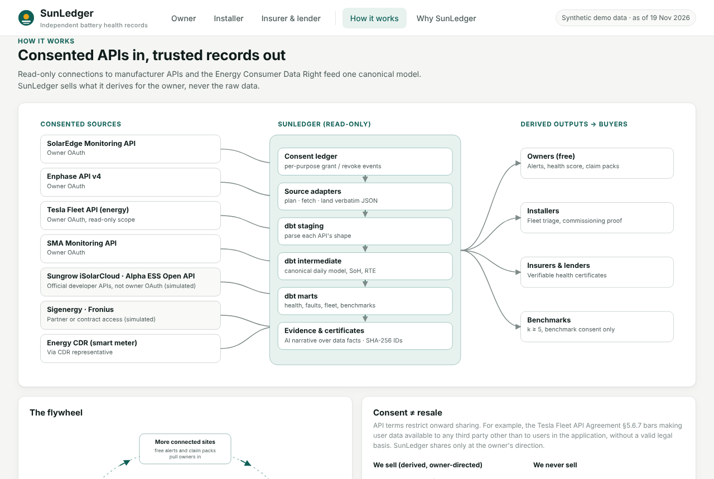 | |

## Quickstart

Requires [uv](https://docs.astral.sh/uv/). uv installs Python 3.12 and every dependency; nothing needs bash.

**Windows (PowerShell)**

```powershell
powershell -ExecutionPolicy ByPass -c "irm https://astral.sh/uv/install.ps1 | iex"   # once
git clone https://github.com/HanL1223/sunledger
cd sunledger
uv sync
uv run sunledger build         # synthetic fixtures -> adapters -> DuckDB -> dbt -> certificates (~30 s)
uv run sunledger export-demo   # rebuild demo/index.html from the marts
uv run sunledger serve         # API docs at http://127.0.0.1:8000/docs
```

**macOS / Linux**

```bash
curl -LsSf https://astral.sh/uv/install.sh | sh
git clone https://github.com/HanL1223/sunledger && cd sunledger && uv sync && uv run sunledger build && uv run sunledger export-demo && uv run sunledger serve
```

| Command | What it does |
|---|---|
| `uv run sunledger build [--sites 220] [--seed N]` | Generate the fleet and API-shaped fixtures, extract them through the adapters, run `dbt build`, issue consented certificates |
| `uv run sunledger models` | Re-run the dbt models only |
| `uv run sunledger export-demo` | Write `demo/index.html` with the data embedded |
| `uv run sunledger serve [--port 8000]` | Run the FastAPI service |
| `uv run sunledger evidence-pack S0001 [--kind certificate_summary] [--out pack.html]` | Render an evidence pack to printable HTML |
| `uv run sunledger certificate issue S0001 --to "Harbourline Home Insurance"` | Issue a certificate to the recipient named in the owner's consent |
| `uv run sunledger certificate verify SLC-...` | Verify a certificate |

**Settings** (environment variables): `SUNLEDGER_SEED`, `SUNLEDGER_SITES`, `SUNLEDGER_AS_OF` (default `2026-11-19`), `SUNLEDGER_HISTORY_START` (default `2025-08-01`), `SUNLEDGER_SYNTHETIC` (default `1`), `SUNLEDGER_LLM_MODEL` (Claude model for the optional narrator), `SUNLEDGER_HOME` (repo root override).

**Call the API.** Demo auth is a header stub (see below):

```powershell
curl.exe -H "X-Demo-Role: owner" -H "X-Demo-Tenant: S0001" http://127.0.0.1:8000/v1/sites/S0001/dashboard
```

```bash
curl -H "X-Demo-Role: owner" -H "X-Demo-Tenant: S0001" http://127.0.0.1:8000/v1/sites/S0001/dashboard
```

**AI narrative (optional).** The demo runs offline with a deterministic template narrator. To have Claude write the evidence-pack summary instead:

```powershell
$env:ANTHROPIC_API_KEY = "<your key>"
uv run --extra llm sunledger export-demo
```

If the call fails, the pack falls back to the template and records which narrator was used.

**Windows notes:** stop `serve` before `build` (DuckDB holds a file lock). Fixture paths stay under about 105 characters below the repo root, so a normal path such as `C:\Users\<you>\dev\sunledger` is fine.

## Architecture and tech decisions

- **ELT, not ETL.** Adapters only extract: they plan requests within each API's window limits (SolarEdge `storageData` is one week per call, for example), fetch them and land the **verbatim JSON** in `raw.api_payloads`. All parsing happens in dbt staging, one model per API shape, so raw payloads stay replayable and auditable when a record is used as evidence.
- **dbt-core + dbt-duckdb, Snowflake-portable.** Staging, intermediate and marts port to Snowflake by switching the profile (DuckDB JSON landing maps to `VARIANT` plus dbt). dbt runs programmatically through `dbtRunner`, so there are no shell scripts. Fault thresholds and the k-anonymity floor are dbt `vars`; fault wording is a seed.
- **Adapters behind one contract.** Each source implements `plan` and is served by a transport. Fixtures are generated from the adapters' own request plans, so swapping `FixtureTransport` for `HttpTransport` (bearer token, 429 back-off) is the only change for real calls.
- **Consent ledger.** Per-purpose grants and revocations are append-only events. Consent-gated marts are views over the ledger, so a revocation takes effect on the next query with no rebuild.
- **AI layer with offline fallback.** "LLM narrates, data decides": every number, table and threshold in an evidence pack is rendered from the marts. The narrator (Claude or the template) writes only the summary paragraph, its prompt forbids new facts, and any API failure falls back to the template.
- **Integrity-checked certificates.** The ID is the first 96 bits of the SHA-256 of the canonical payload (sorted keys, no whitespace, decimals as strings), so any language can reproduce it and the demo page recomputes it in the browser. Signing (KMS) is planned.
- **No real platform per site.** In synthetic mode each site's platform is drawn independently of its fictional product, and every per-site output (dashboard, fleet, packs, certificates, demo) shows only a neutral label: "OEM cloud (owner OAuth)" or "OEM cloud (simulated feed)".
- **Demo auth is a stub.** The API trusts `X-Demo-Role` and `X-Demo-Tenant` headers to show tenant isolation; production replaces this with OIDC role and tenant claims.

<details>
<summary>API endpoints</summary>

| Endpoint | Purpose | Consent gate |
|---|---|---|
| `GET /v1/sources` | Access model per source | n/a |
| `POST /v1/connect/{source}/authorize` | Real-format OAuth authorise URL with read-only scopes; 409 for developer-API and partner-gated sources until their integration is live | n/a |
| `GET/POST /v1/sites/{id}/consents` | Read, grant or revoke a purpose | n/a |
| `GET /v1/sites/{id}/dashboard`, `/alerts` | Health score, SoH trend, generation, faults | `monitoring` |
| `POST /v1/sites/{id}/evidence-pack?kind=warranty_claim\|certificate_summary&format=json\|html` | Evidence pack | `monitoring` |
| `GET /v1/installers/{id}/fleet`, `/sites/{site}/commissioning` | Triage-ranked fleet, commissioning proof | `installer_share` |
| `POST /v1/certificates`, `GET\|POST /v1/certificates/{id}/verify` | Issue to a named recipient; verify, optionally against a presented payload | `certificate` + recipient |
| `GET /v1/benchmarks/installers`, `/brands` | De-identified benchmarks, k >= 5 | `benchmark` |

</details>

<details>
<summary>What the marts compute</summary>

| Output | Method (demo) |
|---|---|
| Expected generation | `pv_kWp x daily POA irradiance (postcode) x 0.80` reference performance ratio |
| Battery state of health | OEM-reported capacity where the API has it (SolarEdge `fullPackEnergyAvailable`, Tesla `total_pack_energy`); otherwise discharge / SoC swing on days with a swing of 40% or more, corrected by sqrt(RTE) |
| Warranty curve | Linear from 100% to 70% at 10 years |
| Round-trip efficiency | Rolling 30-day discharge / charge |
| Faults | `OFFLINE`, `DATA_GAPS`, `STRING_UNDERPERFORMANCE`, `SEASONAL_SHADING`, `INVERTER_CLIPPING`, `ARRAY_OVERSIZED` (CEC 133%), `CAPACITY_BELOW_WARRANTY`, `CAPACITY_FADE_ACCELERATED`, `RTE_DEGRADED` |
| Health score | Generation 30 + capacity 30 + efficiency 15 + availability 15 + faults 10, rescaled over components with data; grades A to E |
| Meter reconciliation | Inverter export vs CDR smart-meter export |
| Benchmarks | Installer and brand cohorts from `benchmark`-consented sites only, suppressed below k = 5; brands pseudonymised as Brand A to H in synthetic mode |

</details>

<details>
<summary>Path to production (AWS sketch)</summary>

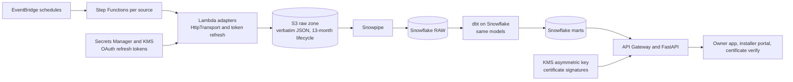

Add dbt freshness checks in CI, incremental `fct_site_daily`, BOM or satellite irradiance per postcode, a KMS signature over each certificate hash with a published revocation list, and row-level access by tenant.

</details>

## What is real vs simulated

| Area | Status |
|---|---|
| API request paths, parameters, window chunking | Modelled on public docs: SolarEdge Monitoring, Enphase v4, Tesla Fleet energy endpoints, CDS Energy `EnergyUsageRead` |
| Payload shapes | Real field names where documented. Simplified: sub-daily telemetry is pre-aggregated to two samples a day; Enphase epochs use a fixed +10:00 offset; SMA set names are approximated; SolarEdge v2 is assumed field-compatible with v1 |
| Tesla `live_status` history | The endpoint has no history; SunLedger is assumed to poll it, and fixtures bundle monthly captures |
| Developer-API and partner-gated OEMs | Simulated through a generic bridge feed, as if access were in place |
| Battery brands, models and capacities | **Fictional** (for example "Halvora HB Series 2, 9.2 kWh"), drawn independently of the data platform; real manufacturer names appear only as API integrations |
| Capacity estimate uncertainty | Assumed about +/-3 points, not yet validated |
| Homes, owners, faults, weather, installers, insurers, consents | Synthetic and seeded (reproducible) |
| OAuth sign-in, notifications, authentication | Mocked; the API returns real-format authorise URLs |
| Pricing, pilot targets, revenue scenario | Hypotheses |

## Risks: what must be true

| Assumption | Why it might fail | How we test it |
|---|---|---|
| Owners connect at handover | Friction, privacy concerns, no immediate pain | Pilot target: 40%+ of new jobs connect |
| Installers pay A$1 to 3 per site per month | Thin margins; OEM portals are free | Signed LOI at A$2 per site per month |
| Insurers and lenders value an owner-consented certificate | Prefer their own data; long procurement | One partner verifying 50+ certificates |
| API access holds | Partner-gated brands cover a large share of installs; developer-API terms (Sungrow, Alpha ESS) unconfirmed; terms change | CDR meter fallback; apply for Sungrow, Alpha ESS and SMA access in month one |
| Capacity estimates are defensible | Estimated SoH uncertainty is assumed at about +/-3 points (unvalidated) without sub-daily data and temperature | Compare against OEM-reported capacity on SolarEdge and Tesla sites |
| Consent model satisfies platform terms | Benchmarks could be read as "making data available" | Legal review of each agreement; benchmarks only from opted-in sites, k >= 5, no raw data |
| Benchmarks resist differencing | A k = 5 cohort before and after one revocation can reveal a site | Publish only k + margin (e.g. 10+), add noise, refresh on a fixed schedule |

Compliance constraints that are not negotiable: per-purpose consent recorded as append-only events; read-only scopes only (SunLedger never dispatches a battery); CDR data only through an accredited arrangement for the consented purpose; evidence packs point to Australian Consumer Law guarantees but are not legal advice.

## 90-day plan

| Window | Goal | Exit criterion |
|---|---|---|
| Days 1 to 30 | Real connections: Enphase Watt plan, SolarEdge v2 app, Tesla Fleet partner registration; Sungrow, Alpha ESS and SMA applications lodged; CDR representative conversations started | Live data from 3 platforms on the founder's and friendly sites |
| Days 31 to 60 | Pilot with one mid-size Victorian installer: handover invite, triage queue, commissioning proof | 25+ consented sites; first P1 caught before a callback |
| Days 61 to 90 | First insurer or lender: certificate verification on real sites; measure triage precision | Pilot success metrics below |

Pilot success metrics (12 weeks, one Victorian installer; same as the brief):

| Metric | Target |
|---|---|
| Owner connect rate at handover | 40%+ of new jobs |
| Benchmark opt-in among connected owners | 50%+ |
| Faults detected before customer callback | 60%+ of eventual callbacks |
| Triage precision (flagged site needed action) | 70%+ |
| Installer willingness to pay at A$2 per site per month | Signed LOI |
| Insurer or lender certificate pilot | 1 partner, 50+ certificates verified |

## Project layout

```
docs/PRODUCT_BRIEF.md          background, problem, personas, requirements, consent model, data sources, metrics
docs/images/                   demo screenshots used in this README
demo/index.html                generated single-file demo (inline CSS/JS/SVG, data embedded)
src/sunledger/
  cli.py                       `sunledger` console script
  config.py                    settings from environment variables
  catalog.py                   fictional products, data sources and access tiers, installers, localities
  adapters/                    one adapter per source, common contract, transports
  synth/                       seeded synthetic world standing in for the real APIs
  warehouse/                   DuckDB connection, raw landing, dbt runner
  evidence/                    narrators (template or Anthropic) and evidence-pack builder
  certificates.py              issue and verify, canonical JSON, SHA-256 IDs
  api.py                       FastAPI service
  export.py                    marts -> demo/index.html
  web/index.template.html      demo page template
warehouse/                     dbt project: staging, intermediate, marts, seeds, macros
```

## License

Proprietary. Copyright (c) 2026 Han Li. All rights reserved. See [LICENSE](LICENSE).

## Sources

- Prime Minister of Australia, [Half a million Cheaper Home Batteries bringing down bills for Australian homes and businesses][pm-500k], 14 Aug 2026.
- ACCC, [Growing home battery uptake delivering lower electricity bills but consumer protections needed][accc], 10 Jul 2026.
- Clean Energy Regulator, [Safety a priority as solar battery installations surge][cer], Feb 2026.
- RenewEconomy, [Australia's top selling home battery issues limited recall over risk of fire][recall], Nov 2025.
- Energy Consumers Australia, [Why households adopt batteries and why many are not joining a VPP][eca], Jul 2026 (cites the ACCC NEM-wide estimate).
- Tesla, [Fleet API Agreement][tesla-agreement] (last updated 21 Mar 2025), §5.6.7: partners may not "rent, lease, sell, sublicense (except as expressly permitted herein), assign, distribute, publish, transfer or otherwise make available the API or Content or User Personal Data to any third party other than to Users in the Application, without a valid legal basis".
- Data-source evidence links are in the [data sources table](#data-sources-and-their-validity).

[pm-500k]: https://www.pm.gov.au/media/half-million-cheaper-home-batteries-bringing-down-bills-australian-homes-and-businesses
[accc]: https://www.accc.gov.au/media-release/growing-home-battery-uptake-delivering-lower-electricity-bills-but-consumer-protections-needed
[cer]: https://cer.gov.au/news-and-media/media/2026/february/safety-priority-solar-battery-installations-surge
[recall]: https://reneweconomy.com.au/australias-top-selling-home-battery-issues-limited-recall-over-risk-of-fire/
[eca]: https://energyconsumersaustralia.com.au/sites/default/files/2026-07/web-doc-report-survey-why-households-adopt-batteries-why-many-arent-joining-vpp.pdf
[se-openhab]: https://next.openhab.org/addons/bindings/solaredge/
[se-ha]: https://community.home-assistant.io/t/solaredge-api-error/1028039
[en-plans]: https://developer-v4.enphase.com/developer-plans
[en-faq]: https://developer-v4.enphase.com/docs/faq
[tesla]: https://developer.tesla.com/docs/fleet-api/endpoints/energy
[tesla-scopes]: https://developer.tesla.com/docs/fleet-api/authentication/overview
[tesla-agreement]: https://digitalassets.tesla.com/tesla-contents/image/upload/Fleet-API-Agreement-EN.pdf
[sma]: https://developer.sma.de/faq
[sg-1]: https://github.com/Afrouper/sungrow-api-client
[sg-2]: https://github.com/jsanchezdelvillar/Sungrow-API
[aess]: https://open.alphaess.com/
[aess-gh]: https://github.com/CharlesGillanders/alphaess-openAPI
[sig]: https://help-center.meteocontrol.com/en/vcom-cloud/latest/sigenergy-northbound-api
[fronius]: https://www.fronius.com/en/solarweb-query-api/api-access
[cdr]: https://cdr.gov.au/sites/default/files/2024-08/CDR-accreditation-guidelines-version-5-published-8-August-2024.pdf
