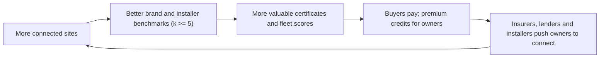

# SunLedger — Product Brief (MVP / demo scope)

*"Carfax for Australia's home batteries."* Independent, retailer-neutral health records for home solar + battery systems.
Status: pre-pilot concept, 20 Nov 2026 (market facts refreshed 25 Nov 2026). Everything in the demo runs on **synthetic data**, and battery brands and models in it are fictional; items marked **[assumption]** are hypotheses to validate in the pilot.

## Background: why this exists

The founding thesis is a **consented data-connection business**: people connect their own accounts through official APIs, get something useful for free, and businesses pay for services built on that data. The key finding from testing it: **consent is not a licence to resell.** Platform terms restrict onward sharing: the [Tesla Fleet API Agreement](https://digitalassets.tesla.com/tesla-contents/image/upload/Fleet-API-Agreement-EN.pdf) §5.6.7 bars partners from making User Personal Data available "to any third party other than to Users in the Application, without a valid legal basis", which fits an owner-directed model. So SunLedger sells **derived outputs** produced for, or at the direction of, the owner (health records, certificates, evidence packs, fleet triage) and never raw data. Home batteries are the first wedge because the asset is expensive, warranty-bound, newly mass-market and poorly evidenced.

## Data sources: checked 25 Nov 2026 (public sources)

| Source | Access model | Status | Evidence |
|---|---|---|---|
| SolarEdge Monitoring API v2 | Registered app (client ID/secret) on SolarEdge ONE for Developers, then OAuth 2.0 per site; calls consume monthly credits | V2 only: V1 retired in early Nov 2026 and now returns errors ([report](https://www.smarthomeassistent.de/solaredge-api-v1-abgeschaltet-home-assistant/)) | [openHAB binding](https://next.openhab.org/addons/bindings/solaredge/), [HA community](https://community.home-assistant.io/t/solaredge-api-error/1028039) |
| Enphase API v4 | Self-serve portal; system-owner authorisation; Watt plan free (1,000 hits/month), Kilowatt/Megawatt paid | Live | [Plans](https://developer-v4.enphase.com/developer-plans), [FAQ](https://developer-v4.enphase.com/docs/faq) |
| Tesla Fleet API (energy) | Partner account + virtual key; read scope `energy_device_data`; `live_status`, `site_info`, `calendar_history`; §5.6.7 limits onward sharing; pay-per-use, energy data capped at 1 request per site per 5 min ([limits](https://developer.tesla.com/docs/fleet-api)) | Live | [Energy endpoints](https://developer.tesla.com/docs/fleet-api/endpoints/energy), [scopes](https://developer.tesla.com/docs/fleet-api/authentication/overview), [Agreement](https://digitalassets.tesla.com/tesla-contents/image/upload/Fleet-API-Agreement-EN.pdf) |
| SMA | OAuth code flow; client credentials set up by SMA API Developer Support (not self-serve) | Live, assisted onboarding | [SMA developer FAQ](https://developer.sma.de/faq) |
| Sungrow iSolarCloud | Official developer portal (developer-api.isolarcloud.com); API key or OAuth2 | Official API; app review reported by one developer, not confirmed in Sungrow docs (simulated in demo) | [sungrow-api-client](https://github.com/Afrouper/sungrow-api-client), [Sungrow-API](https://github.com/jsanchezdelvillar/Sungrow-API) |
| Alpha ESS | Official Open API on the AlphaCloud developer platform; free developer registration (AppID/secret); systems bound by serial number and check code, not owner OAuth | Official API (simulated in demo) | [open.alphaess.com](https://open.alphaess.com/), [alphaess-openAPI](https://github.com/CharlesGillanders/alphaess-openAPI) |
| Sigenergy | Northbound API used by monitoring platforms; owner authorises API access in their Sigenergy account; no public developer docs found as of 20 Nov 2026 | Partner / integration access (simulated in demo) | [meteocontrol guide](https://help-center.meteocontrol.com/en/vcom-cloud/latest/sigenergy-northbound-api) |
| Fronius | Solar.web Query API for business partners: contract, order form and paid data packages (free demo on sample systems only) | Contract-based (simulated in demo) | [Fronius API access](https://www.fronius.com/en/solarweb-query-api/api-access) |
| Energy CDR | CDR representative model: an unaccredited business uses CDR data under an unrestricted accredited person; meter and tariff data only, no inverter data | Live in energy since Nov 2022 | [CDR accreditation guidelines v5](https://cdr.gov.au/sites/default/files/2024-08/CDR-accreditation-guidelines-version-5-published-8-August-2024.pdf) |

## 1. Problem

- **Volume is outrunning assurance.** 569,000+ solar batteries (16.44 GWh) installed from 1 Jul 2025 to 30 Sep 2026 [6], many by installers new to storage.
- **Usable capacity is now the unit of money.** Since 1 May 2026 the rebate is paid per usable kWh in tiers (first 14 kWh at 100%, 14–28 kWh at 60%, 28–50 kWh at 15%), stepping down each Jan and Jul to 2030 [7]. Price and rebate both rest on the quoted usable kWh, and nobody independent checks that the installed system delivers it.
- **Consumer reports are rising and problems are hard to resolve.** ACCC (Jul 2026): consumer reports about household batteries and new energy services up 107% in 12 months — unsuitable systems, faulty installs, poor performance. The New Energy Tech Consumer Code has no independent dispute resolution, so owners need their *own* evidence.
- **Quality and safety signals are real.** Of 4,322 CER inspections of rebated battery installs, 59.7% were substandard and 0.86% unsafe; the defects were workmanship (labels, wiring, RCDs), not the batteries [6] (telemetry cannot see these, so SunLedger does not claim to); earlier context [1]; a top-selling AU brand reportedly issued a limited fire-risk recall of some energy controllers in Nov 2025 [2].
- **Nobody neutral owns the record.** OEM apps grade their own homework; Solar Analytics (A$6/mo inverter plan, no extra hardware [3]) has been owned by device maker Catch Power since 2024 [4]; Amber optimises trading. VPP participation among battery owners across the NEM is ~24% by ACCC estimate, and 4–10% in an Energy Consumers Australia survey [5]; many distrust ceding control.

Sources: [1] [CER media release, 25 Feb 2026](https://cer.gov.au/news-and-media/media/2026/february/safety-priority-solar-battery-installations-surge). [2] [RenewEconomy, 24 Nov 2025](https://reneweconomy.com.au/australias-top-selling-home-battery-issues-limited-recall-over-risk-of-fire/). [6] [CER solar battery inspection results, data to 30 Sep 2026](https://cer.gov.au/schemes/renewable-energy-target/small-scale-renewable-energy-scheme/small-scale-renewable-energy-systems/small-scale-renewable-energy-system-inspections/solar-battery-inspection-results-report). [7] [Energy Matters, Nov 2026](https://www.energymatters.com.au/renewable-news/battery-rebate-1-january-2027-fake-deadline/). [3] [Solar Analytics pricing](https://solaranalytics.com.au/pricing) (checked 20 Nov 2026). [4] [One Step Off The Grid, 10 May 2024](https://onestepoffthegrid.com.au/catch-power-buys-solar-analytics-to-create-home-energy-optimisation-dream-team/). [5] [Energy Consumers Australia, Jul 2026](https://energyconsumersaustralia.com.au/sites/default/files/2026-07/web-doc-report-survey-why-households-adopt-batteries-why-many-arent-joining-vpp.pdf) (cites the ACCC estimate).

**Gap:** a retailer-neutral, read-only, cross-brand *health and warranty-evidence record* — plus benchmarks across brands and installers that no single OEM or retailer can produce.

## 2. Personas

| Persona | Job to be done | Pain today |
|---|---|---|
| **Owner** (e.g. rebate-funded household, Werribee VIC) | "Is my battery doing what I paid for? If not, get it fixed under warranty." | OEM app shows SoC, not degradation vs warranty; no evidence that will stand up with installer/manufacturer. |
| **Installer ops manager** (mid-size VIC installer, 40–150 jobs/month [assumption]) | "Find sick systems before the customer calls; prove my installs were right." | Callbacks are reactive; data split across 4–6 OEM portals [assumption]; disputes are he-said-she-said. |
| **Insurer / lender (underwriter)** | "Price the battery risk on this property / loan." | Pricing an A$10k+ asset [assumption] blind: no independent condition data, only install date and brand. |

## 3. MVP functional requirements

1. **Connect** a system via owner OAuth (SolarEdge v2, Enphase v4, SMA, Tesla Fleet energy endpoints) and optionally Energy CDR smart-meter data. Sungrow and Alpha ESS (official developer APIs, not owner OAuth) are ingested once SunLedger's integration is live; Sigenergy and Fronius are flagged and only ingested once a partner agreement or contract exists.
2. **Normalise** every source to one canonical daily model: generation, battery charge/discharge, SoC range, reported or estimated usable capacity, grid import/export, data availability.
3. **Analyse:** handover capacity check (median capacity in the first 60 days vs the quoted usable kWh; below 95% raises `CAPACITY_SHORT_AT_HANDOVER`, routed to the installer, not the manufacturer), expected-vs-actual generation (irradiance model), battery State-of-Health (SoH) and trend vs the warranty curve (70% at 10 years), round-trip efficiency (RTE), rule-based fault classification, and an explainable 0–100 health score.
4. **Alert** the owner (and installer, if the owner allows) with plain-English explanations.
5. **Evidence pack:** one-click warranty / Australian Consumer Law (ACL) claim pack for the owner; certificate summary for the insurer/lender. AI writes the narrative; numbers always come from the data.
6. **Installer fleet:** triage-ranked fleet table, site drill-down, handover performance and capacity record (performance evidence, not an electrical-compliance check).
7. **Certificates:** issue a battery health certificate whose ID is derived from a SHA-256 content hash, so anyone holding the ID can integrity-check it (signing planned).
8. **Benchmarks:** installer and brand quality benchmarks from benchmark-consented sites only, with minimum cohort size (k ≥ 5).

**Non-goals (MVP):** controlling or dispatching batteries (read-only by design — the trust wedge vs VPPs); energy trading / tariff optimisation; sub-daily fault analytics; installer CRM / job management; selling raw telemetry to anyone.

## 4. Consent & data-rights model

**Principle: consent ≠ resale.** API terms (e.g. Tesla Fleet §5.6.7) prohibit selling or making user data available. SunLedger never resells raw data; it sells **derived outputs** produced *for* the owner or with the owner's explicit direction.

| Purpose (separate toggle) | Default | Enables | Who sees output |
|---|---|---|---|
| `monitoring` | Required | Health score, alerts, evidence packs | Owner (+ installer of record if owner opts in) |
| `installer_share` | Off | Site appears in installer's fleet view | Named installer |
| `benchmark` | Off, separately asked | De-identified, aggregated (k ≥ 5) brand/installer benchmarks | Installers, insurers (aggregates only) |
| `certificate` | Off, per recipient | Issue a health certificate to a named insurer/lender | Named recipient |
| `cdr_meter` | Off | Smart-meter cross-check of inverter claims (via CDR representative arrangement) | Owner |

- **Revocation:** any purpose can be revoked at any time; revoking `monitoring` stops ingestion, revokes OAuth tokens and schedules deletion. Revoked benchmark consent removes the site from benchmarks immediately (consent-gated marts are views over the consent ledger). Revoking `certificate` or `monitoring` revokes that site's issued certificates.
- **Differencing risk:** comparing a k = 5 cohort before and after one revocation could reveal that site's values. Mitigation before launch: publish only cohorts of k + margin (e.g. ≥ 10) and/or add calibrated noise, and refresh published benchmarks on a fixed schedule rather than per change.
- **Retention [assumption]:** raw API payloads 13 months (enough for a seasonal baseline), derived daily facts for system life while consented, issued certificates 7 years (lender record-keeping); deletion within 30 days of revocation.
- **Data minimisation:** no PII in the warehouse beyond postcode and owner display name; sites keyed by surrogate IDs.

## 5. The data flywheel

1. Owners connect for free alerts + claim packs. 2. Benchmark-consented sites form cohorts per brand / installer / climate zone. 3. Cohorts make certificates comparable ("this battery is in the top quartile for its brand and age"). 4. Insurers/lenders and installers pay for those outputs and **nudge their customers to connect** (premium credit, faster loan approval, installer warranty extension). 5. Loop.

## 6. Customer journeys (trigger → value moment → paid moment)

**Owner (free):** trigger: rebate install / bill shock / neighbour's story → connect OEM account (2 min OAuth), choose purposes → *value:* health score + "your battery holds 88.7% of its rated capacity after 15 months; the warranty curve allows 96.2%" alert → one-click warranty/ACL evidence pack sent to installer → optional: share certificate with insurer for a premium credit. *Paid moment:* none for the owner; the paying party is the installer/insurer they share with.

**Installer ops manager:** trigger: callback costs + CER inspection anxiety → owners at handover are invited to connect (installer-branded) → *value:* morning triage list ranks the 5 sites that need a truck, before customers call → handover capacity and performance record attached to each job file → benchmark vs anonymous peers. *Paid moment:* A$1–3 per site/month once fleet > 25 sites **[assumption]**.

**Insurer / lender (underwriter):** trigger: battery on a home policy / green loan application → owner shares certificate ID → *value:* verify ID, see SoH vs warranty, fault history, cohort percentile → portfolio view of risk by brand and age. *Paid moment:* A$20–50 per certificate **[assumption]**; later, portfolio monitoring subscription. **Phase 2:** insurers are starting to ask about lithium-ion risk (Nov 2026), but the claims growth they cite is mostly e-bikes and tools, and no condition-based home-battery pricing was found, so installers stay the first buyer.

## 7. Selling points per buyer

- **Owner:** free, independent, read-only (never touches your battery); evidence that speaks the installer's and manufacturer's language; works across brands.
- **Installer:** one fleet view across OEM portals; fewer and cheaper callbacks; a handover record showing each system delivered its quoted capacity and expected output (useful in disputes; it does not cover the wiring and labelling items CER inspects); peer benchmark as a marketing asset. *vs Solar Analytics:* battery-health and warranty-evidence focus, independent of any device maker.
- **Insurer / lender (underwriter):** an independent, verifiable condition record for an asset that is currently priced blind; portfolio concentration by brand/age; owner-consented and auditable. *vs OEM data:* cross-brand, not self-reported by the manufacturer; corroborated by the smart meter where CDR is connected.

## 8. Pilot success metrics (12 weeks, one VIC installer)

| Metric | Target |
|---|---|
| Owner connect rate at handover | ≥ 40% of new jobs |
| Benchmark opt-in among connected owners | ≥ 50% |
| Faults detected before customer callback | ≥ 60% of eventual callbacks |
| Triage precision (flagged site needed action) | ≥ 70% |
| Installer willingness to pay at A$2/site/month | signed LOI |
| Insurer/lender certificate pilot | 1 partner, ≥ 50 certificates verified |

## 9. Key risks & simplifications in the demo

- **API access:** partner-gated brands cover a large share of AU installs; until agreements exist (or the Sungrow and Alpha ESS integrations are live), those sites fall back to CDR meter data only. The demo *simulates* that access and flags it.
- **Capacity estimation [simplification]:** SolarEdge (`fullPackEnergyAvailable`) and Tesla (`total_pack_energy`) report capacity; for others SunLedger estimates usable capacity from discharge energy ÷ SoC swing on deep-cycle days. Real deployments need sub-daily data and temperature correction.
- **Irradiance [simplification]:** seeded clear-sky × cloudiness model per postcode; production would use BOM/satellite irradiance.
- **Legal:** evidence packs summarise facts and point to ACL consumer guarantees; they are not legal advice.
- API payload shapes are modelled on public docs (SolarEdge Monitoring, Enphase v4, Tesla Fleet energy, CDS Energy) and simplified to daily granularity where noted.
